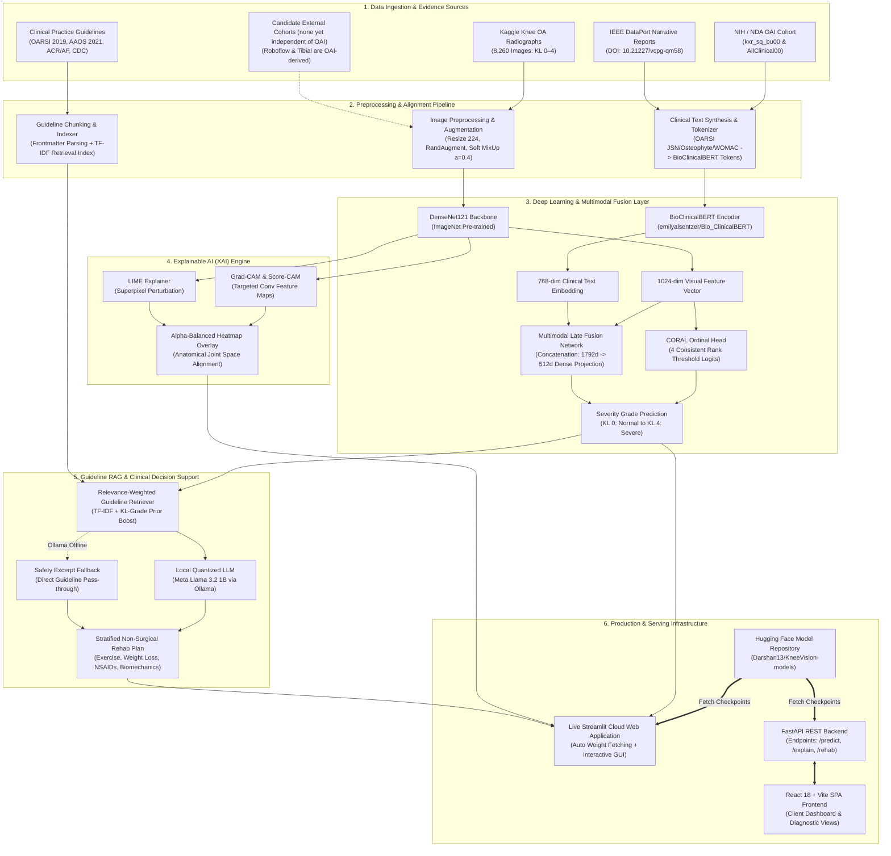

# KneeVision++

**Explainable Multimodal AI & Deep Ordinal Staging for Knee Osteoarthritis**

[](https://kneevision-rqfxrsksbrmvngvxm5uusl.streamlit.app/)
[](https://huggingface.co/Darshan13/KneeVision-models)
[](https://www.kaggle.com/datasets/tommyngx/knee-osteoarthritis-dataset-with-severity)
[](https://nda.nih.gov/oai)
[](https://doi.org/10.21227/vcpg-qm58)
[](https://universe.roboflow.com/srm-zubpb/knee-oa-detection)
[](https://doi.org/10.17632/6gbptmgp3y.1)
[](https://github.com/astral-sh/uv)
[](https://pytorch.org/)
[](https://fastapi.tiangolo.com/)
[](https://vitejs.dev/)
[](tests/)

---

## 📌 Overview

**KneeVision++** is an end-to-end multimodal deep learning and clinical reasoning framework designed for severity grading of knee osteoarthritis (OA) according to the Kellgren–Lawrence (KL grades 0–4) ordinal staging scale.

The system integrates:
1. **Ordinal Computer Vision:** Consistent Rank Logits (CORAL) on DenseNet121 with continuous soft cumulative targets and MixUp data regularization, yielding state-of-the-art ordinal concordance while eliminating extreme classification errors.
2. **Explainable AI (XAI):** Native, mathematically calibrated visual explanation maps (Grad-CAM, Score-CAM, and LIME) blended with source radiographs to illuminate joint space narrowing and marginal osteophytes.
3. **Clinical Natural Language Processing:** Fine-tuned BioClinicalBERT encoding patient demographics, symptom scores (WOMAC), and semi-quantitative OARSI radiographic assessments.
4. **Multimodal Late Fusion:** A joint multimodal neural architecture combining 1024-dimensional visual features with 768-dimensional clinical language representations.
5. **Guideline-Grounded Retrieval-Augmented Generation (RAG):** Local LLM synthesis (`llama3.2:1b` via Ollama) retrieving international clinical practice guidelines (OARSI, AAOS, ACR/Arthritis Foundation, CDC) to provide stratified non-surgical rehabilitation guidance.
6. **Production Deployments:** A live, cloud-deployed interactive Streamlit web application and a decoupled client-server architecture (FastAPI backend + React/Vite SPA).

> ⚠️ **Investigational Research Disclaimer:** KneeVision++ is a research and educational prototype evaluated on retrospective clinical cohorts. It is **not** an FDA-cleared or CE-marked medical device and must **not** be used as an autonomous diagnostic tool or a substitute for professional clinical judgment.

---

## 🌐 Live Demos, Hubs & Deployed Links

### Quick Reference Portal

| Resource / System | Description | Direct URL |
| :--- | :--- | :--- |
| **🚀 Streamlit Live App** | Interactive cloud deployment with inference, Grad-CAM/LIME, and RAG rehab advisor | [kneevision-rqfxrsksbrmvngvxm5uusl.streamlit.app](https://kneevision-rqfxrsksbrmvngvxm5uusl.streamlit.app/) |
| **🤗 Hugging Face Model Hub** | Model repository with checkpoints (`.pt`) and evaluation metadata (`.json`) | [huggingface.co/Darshan13/KneeVision-models](https://huggingface.co/Darshan13/KneeVision-models) |
| **📊 Kaggle Knee OA Dataset** | 8,260 plain knee radiographs across 5 KL grades (Train/Val/Test splits) | [kaggle.com/datasets/tommyngx/knee-osteoarthritis-dataset-with-severity](https://www.kaggle.com/datasets/tommyngx/knee-osteoarthritis-dataset-with-severity) |
| **🏥 NIH NIMH Data Archive (NDA)** | Osteoarthritis Initiative (OAI) clinical tables (`kxr_sq_bu00.txt`, `AllClinical00.txt`) | [nda.nih.gov/oai](https://nda.nih.gov/oai) |
| **📑 IEEE DataPort Reports** | Expert-annotated radiology reports for Knee OAI dataset (DOI: 10.21227/vcpg-qm58) | [doi.org/10.21227/vcpg-qm58](https://doi.org/10.21227/vcpg-qm58) |
| **🔍 Roboflow Universe** | Re-export of OAI knee radiographs (1,965 images, CC BY 4.0); **not independent** of the Kaggle set | [universe.roboflow.com/srm-zubpb/knee-oa-detection](https://universe.roboflow.com/srm-zubpb/knee-oa-detection) |
| **🦴 Mendeley Data** | Tibial Spiking Knee OA Dataset (DOI: 10.17632/6gbptmgp3y.1) | [doi.org/10.17632/6gbptmgp3y.1](https://doi.org/10.17632/6gbptmgp3y.1) |
| **🩺 BioClinicalBERT** | Pre-trained clinical language model on Hugging Face | [huggingface.co/emilyalsentzer/Bio_ClinicalBERT](https://huggingface.co/emilyalsentzer/Bio_ClinicalBERT) |
| **🦙 Meta Llama 3.2 1B (Ollama)** | Local quantized LLM for guideline-grounded rehabilitation generation | [ollama.com/library/llama3.2](https://ollama.com/library/llama3.2) |
| **🐙 GitHub Source Code** | Complete implementation, tests, evaluation scripts, and audits | [github.com/Darshan-T-P/KneeVision](https://github.com/Darshan-T-P/KneeVision) |

- **Hosted LLM for the rehab advisor (Streamlit Cloud):** Ollama cannot run on Community Cloud, so set
  `XAI_API_KEY` (and optionally `XAI_MODEL`, `LLM_PROVIDER=auto`) under *App settings → Secrets*; see
  [`.streamlit/secrets.toml.example`](.streamlit/secrets.toml.example). Without a key the app falls back to showing
  the retrieved guideline excerpts. Any OpenAI-compatible API also works via `LLM_PROVIDER=openai-compatible`,
  `LLM_BASE_URL`, `LLM_MODEL`, `LLM_API_KEY`. The patient-context text is sent to the provider, so the app warns
  users not to enter identifying details.
- **Cold Start Notice:** On Streamlit Community Cloud cold starts, the app automatically fetches required model weights from the Hugging Face repository above (`ensure_checkpoints()`). Subsequent runs reuse the cached weights.
- **Hugging Face Model Checkpoints hosted:**
  - `best_densenet121_ordinal_ordinal_soft_mixup_a04.pt` (Final locked CORAL ordinal model)
  - `best_densenet121.pt` (Standard multi-class DenseNet121 baseline)
  - `best_efficientnet-b4.pt` (EfficientNet-B4 baseline)
  - `best_convnext_small_binary.pt` (Binary screening ConvNeXt-Small)
  - `best_clinical.pt` (BioClinicalBERT clinical text encoder)
  - `best_fusion.pt` (Multimodal late fusion network)

---

## 📊 Final Research Audit & Benchmark Results

### 1. Locked CORAL Ordinal Model vs. Baseline (Held-Out Test Set, $N = 1,656$)

Evaluated on the frozen, patient-isolated held-out test split (828 unique patients, zero overlap with train/val):

| Metric | Hard-Target CORAL Baseline | Locked Soft CORAL + MixUp ($\alpha = 0.4$) | Absolute Gain |
| :--- | :---: | :---: | :---: |
| **Quadratic Weighted Kappa (QWK)** | 0.7798 | **0.8232** (95% CI: [0.8036, 0.8398]) | **+0.0434** |
| **Mean Absolute Error (MAE)** | 0.4577 | **0.3925** (95% CI: [0.3641, 0.4215]) | **-0.0652** |
| **Within-1 Grade Accuracy ($|y - \hat{y}| \le 1$)** | 95.65% | **96.92%** (95% CI: [96.14%, 97.77%]) | **+1.27 pp** |
| **Within-2 Grade Accuracy ($|y - \hat{y}| \le 2$)** | 99.88% | **100.00%** (1,656 / 1,656) | **+0.12 pp** |
| **Extreme Errors ($|y - \hat{y}| \ge 3$)** | 2 cases | **0 cases (0.00%)** | **Eliminated** |
| **Exact 5-Class Accuracy** | 58.64% | **63.83%** (95% CI: [61.23%, 66.31%]) | **+5.19 pp** |
| **Linear Weighted Kappa** | 0.6475 | **0.6831** | **+0.0356** |
| **Macro-F1** | 0.5630 | **0.6269** | **+0.0639** |
| **Expected Calibration Error (ECE)** | 0.0821 | **0.0496** | **-0.0325** |
| **Macro Brier Score** | 0.1124 | **0.0947** | **-0.0177** |

*Checkpoint SHA256:* `c639bd883715637d578d73898116089283c19c0f8b4e30d9bcd51f8d75939f68` (Epoch 25, selected solely on validation QWK 0.8009).

### 1b. Seed Robustness (4 seeds, held-out test set)

Soft CORAL + MixUp 0.4: test QWK **0.8163 ± 0.0128** (seeds 42/7/123/2024 = 0.8232/0.8202/0.7973/0.8244), validation QWK 0.7994 ± 0.0037. Adding OARSI auxiliary heads (multitask, same recipe, 3 seeds): test QWK **0.8276 ± 0.0023** (+0.011, much lower variance; KL3-recall gain did not replicate across seeds). Focal (no MixUp), 3 seeds: test QWK 0.7853 ± 0.0230. The locked checkpoint is seed 42. CORAL is ~0.03 QWK higher and more stable across seeds, but with few seeds and no significance test this is supportive evidence, not proof. Full tables: [`reports/SEED_ROBUSTNESS.md`](reports/SEED_ROBUSTNESS.md).

### 2. Test Confusion Matrix & Error Topology

```
             Predicted Grade
            KL0   KL1   KL2   KL3   KL4    Total
True  KL0   501   120    18     0     0     639
      KL1    99   138    59     0     0     296
      KL2    16   135   287     9     0     447
      KL3     0    15   106    97     5     223
      KL4     0     0     2    15    34      51
     Total  616   408   472   121    39   1,656
```

- **Adjacent Errors ($|y - \hat{y}| = 1$):** 548 cases (**91.49%** of all errors).
- **Non-Adjacent Errors ($|y - \hat{y}| = 2$):** 51 cases (**8.51%** of all errors).
- **Directional Bias:** 64.77% under-grading vs. 35.23% over-grading (conservative clinical bias favoring adjacent lower grades over over-calling severity).

### 3. Post-Hoc Grouped Screening Benchmarks

Derived via post-hoc linear re-aggregation of the frozen test confusion matrix (zero test set re-use or re-inference):
- **Binary Screening (No OA [KL0–1] vs. Definite OA [KL2–4]):**
  - **Accuracy:** **85.33%** (1,413 / 1,656)
  - **Macro-F1:** **0.8482** (No OA F1: 0.8760, OA F1: 0.8204)
  - **Unweighted Cohen's $\kappa$:** **0.6973**
- **3-Class Clinical Triage (None/Doubtful [KL0–1] vs. Mild [KL2] vs. Moderate/Severe [KL3–4]):**
  - **Accuracy:** **78.26%** (1,296 / 1,656)
  - **Macro-F1:** **0.7321**
  - **QWK:** **0.7622**

### 4. Multimodal Fusion Benchmark

> Retraining fusion on the locked CORAL image encoder (`models/best_fusion_coral.pt`) gave accuracy 88.71% / QWK 0.9579 vs 88.89% / 0.9586 for the original fusion model, i.e. no meaningful change; the text branch dominates.

| Modality / Architecture | Exact Accuracy | Quadratic Weighted Kappa (QWK) |
| :--- | :---: | :---: |
| **Image Only (DenseNet121)** | 60.3% | 0.792 |
| **Clinical Text Only (BioClinicalBERT)** | 87.4% | 0.953 |
| **Multimodal Neural Fusion (CNN + BERT)** | **88.9%** | **0.959** |

> ℹ️ **Scientific Disclosure on Clinical Text & Fusion Performance:**  
> The Kellgren–Lawrence grade is clinically defined by joint space narrowing (JSN), osteophyte formation, and subchondral sclerosis. The BioClinicalBERT model is trained on structured clinical reports encoding real, independently scored per-compartment OARSI radiographic grades from `kxr_sq_bu00.txt`.  
> While the explicit KL grade string is omitted (preventing direct label leakage), these per-compartment structural findings represent the *definitional components* of the KL scale. Consequently, text-only classification approaches near-deterministic rule decoding. This explains why multimodal fusion provides a modest incremental gain (+1.5 pp accuracy, +0.006 QWK) over text alone: the clinical text branch already encapsulates the primary radiographic criteria.

---

## 📚 Datasets & Evidence Sources

KneeVision++ synthesizes multiple public medical imaging, clinical tabular, narrative text, and practice guideline sources:

### 1. Imaging Datasets
- **Kaggle Knee Osteoarthritis Dataset:**
  - **Direct URL:** [https://www.kaggle.com/datasets/tommyngx/knee-osteoarthritis-dataset-with-severity](https://www.kaggle.com/datasets/tommyngx/knee-osteoarthritis-dataset-with-severity)
  - **Scope:** 8,260 high-resolution plain knee radiographs across 5 Kellgren–Lawrence grades (KL 0 to 4).
  - **Splits:** Train ($N = 5,778$), Validation ($N = 826$), Held-out Test ($N = 1,656$).
  - **Validation & Sanctity:** Strict patient-level separation verified via filename prefix matching ($0$ shared patients across any split). Unpacked from `data/archive.zip` to `data/raw/{train,val,test}/{kl_grade}/*.png`.
- **Independent external cohort — Gornale & Patravali "Digital Knee X-ray Images" ([doi:10.17632/t9ndx37v5h.1](https://doi.org/10.17632/t9ndx37v5h.1), CC BY 4.0):** 1,650 hospital X-rays, KL 0–4 by two experts. Evaluated without retraining via `scripts/run_external_eval.sh` → `reports/external_gornale/`. Result: **QWK ≈ 0.60–0.61, accuracy ≈ 35%, binary AUC ≈ 0.83–0.84** (internal QWK 0.82–0.83), with sensitivity ≈ 97% but specificity ≈ 43%. Generalization to a new scanner/hospital is the main open limitation. Cheap adaptation helps: re-estimating BatchNorm statistics on unlabelled external images lifts DenseNet QWK to ≈ 0.68 and recalibrating the CORAL thresholds with 50 labelled images to ≈ 0.72 (held-out 70% of the cohort; `reports/external_adapt/SUMMARY.md`, details in the audit). Histogram-equalization preprocessing made it worse. Domain-robust training (aspect/resolution/gamma/noise augmentation + per-image standardization) improved external zero-shot QWK from 0.64 to 0.72 and, with 50-label recalibration, reached QWK 0.77 and ≈ 84% external binary accuracy (2 seeds, 40-epoch schedule; see the audit).
- **Roboflow Knee OA Detection (NOT an external cohort):**
  - **Direct URL:** [https://universe.roboflow.com/srm-zubpb/knee-oa-detection](https://universe.roboflow.com/srm-zubpb/knee-oa-detection)
  - **Scope:** 1,965 annotated knee radiographs exported under CC BY 4.0.
  - **Audit finding (2026-10-12):** all 1,220 distinct knee IDs in the Roboflow export also appear in the Kaggle/OAI set (resized copies), so evaluating on it would measure training-set overlap, not generalization. No result from it is reported.
  - **Use Case:** Only usable via [`scripts/evaluate_external.py`](scripts/evaluate_external.py) once a genuinely independent cohort (e.g. MOST, CHECK) is supplied.
- **Tibial Spiking Knee OA Dataset (Mendeley Data):**
  - **Direct DOI URL:** [https://doi.org/10.17632/6gbptmgp3y.1](https://doi.org/10.17632/6gbptmgp3y.1)
  - **Mendeley Data Portal:** [https://data.mendeley.com/datasets/6gbptmgp3y/1](https://data.mendeley.com/datasets/6gbptmgp3y/1)
  - **Citation:** Marko Moilanen, Tommi Grönholm, Juha Paloneva, Sami Äyrämö, *"Tibial Spiking Knee OA Dataset"*, Mendeley Data, V1, 2024.
  - **Audit note:** file names carry OAI patient IDs (e.g. `9398120L`), so this is also OAI-derived and not an external cohort.
  - **Clinical Focus:** High-resolution plain radiograph crops of the tibial intercondylar eminence (tibial spine elongation), evaluated as a sensitive structural marker for early knee osteoarthritis progression.

### 2. Clinical Assessment & Radiographic Readings
- **Osteoarthritis Initiative (OAI) via NIH NIMH Data Archive (NDA):**
  - **Study Portal:** [https://nda.nih.gov/oai](https://nda.nih.gov/oai)
  - **Study Documentation:** [https://nda.nih.gov/oai/study_documentation](https://nda.nih.gov/oai/study_documentation)
  - **Access Registration:** [https://nda.nih.gov/nda/creating-an-nda-account](https://nda.nih.gov/nda/creating-an-nda-account)
  - **Data Access & DUC:** [https://nda.nih.gov/oai/data_access](https://nda.nih.gov/oai/data_access)
  - **Scope:** Multicenter, prospective 9-year longitudinal cohort of 4,796 participants tracking knee OA biomarkers and outcomes.
  - **Tables Ingested:**
    - `kxr_sq_bu00.txt`: Gold-standard central radiologist readings (Project 15) capturing KL grades, medial/lateral joint space narrowing (JSN 0–3), marginal osteophytes (0–3), subchondral sclerosis (0–1), and bone attrition (0–3).
    - `AllClinical00.txt`: Baseline clinical assessments (age, sex, BMI, WOMAC pain/stiffness/function, injury, surgery, and medication history).
  - **Pipeline & Ingestion:** Processed via [`scripts/download_oai.py`](file:///home/darshan/Projects/Research/KneeVision/scripts/download_oai.py) yielding 11,574 train / 2,540 val / 2,478 test records with zero subject bleed (see [`data/oai/README.md`](file:///home/darshan/Projects/Research/KneeVision/data/oai/README.md)).
- **IEEE DataPort Expert-Annotated Radiology Reports:**
  - **Direct DOI URL:** [https://doi.org/10.21227/vcpg-qm58](https://doi.org/10.21227/vcpg-qm58)
  - **IEEE DataPort Portal:** [https://ieee-dataport.org/documents/expert-annotated-radiology-reports-knee-oai-dataset](https://ieee-dataport.org/documents/expert-annotated-radiology-reports-knee-oai-dataset)
  - **Citation:** Akshay Daydar, *"Expert annotated radiology Reports for Knee OAI dataset"*, IEEE DataPort, 2021.
  - **Use Case:** Expert radiologist-written narrative report texts paired with OAI imaging studies.

### 3. Foundation Models & Hugging Face Checkpoints
- **Hugging Face Model Repo:** [`Darshan13/KneeVision-models`](https://huggingface.co/Darshan13/KneeVision-models) — official model hub hosting locked PyTorch weights and evaluation artifacts.
- **BioClinicalBERT:** [`emilyalsentzer/Bio_ClinicalBERT`](https://huggingface.co/emilyalsentzer/Bio_ClinicalBERT) — clinical domain BERT encoder pretrained on MIMIC-III clinical records (Emily Alsentzer et al., 2019).
- **Vision Backbones:** [Torchvision ImageNet Pretrained Models](https://pytorch.org/vision/stable/models.html) — DenseNet121, EfficientNet-B4, ViT-B/16, and ConvNeXt-Small.
- **Local RAG LLM:** Meta Llama 3.2 1B ([`llama3.2:1b`](https://ollama.com/library/llama3.2)) served locally via [Ollama](https://ollama.com).

### 4. Clinical Practice Guidelines (RAG Corpus)
The RAG rehabilitation guidance pipeline retrieves from an original, cited synthesis of international orthopedic consensus standards located in [`data/guidelines/`](file:///home/darshan/Projects/Research/KneeVision/data/guidelines/):
- **OARSI (2019):** Bannuru RR, et al. *OARSI guidelines for the non-surgical management of knee, hip, and polyarticular osteoarthritis.* Osteoarthritis and Cartilage. [oarsi.org Guidelines](https://oarsi.org/education/oarsi-guidelines) \| [DOI: 10.1016/j.joca.2019.06.011](https://doi.org/10.1016/j.joca.2019.06.011)
- **AAOS (2021):** American Academy of Orthopaedic Surgeons. *Management of Osteoarthritis of the Knee (Non-Arthroplasty), Evidence-Based Clinical Practice Guideline, 3rd Edition.* [AAOS Guideline Portal](https://www.aaos.org/quality/quality-programs/lower-extremity-programs/osteoarthritis-of-the-knee/) \| [Full Guideline PDF](https://www.aaos.org/globalassets/quality-and-practice-resources/osteoarthritis-of-the-knee/oak3cpg.pdf)
- **ACR / Arthritis Foundation (2019):** Kolasinski SL, et al. *2019 American College of Rheumatology/Arthritis Foundation Guideline for the Management of Osteoarthritis of the Hand, Hip, and Knee.* Arthritis Care & Research. [DOI: 10.1002/art.41142](https://doi.org/10.1002/art.41142)
- **CDC:** *Talking to Patients About Self-Management & Physical Activity for Arthritis.* [CDC Arthritis Portal](https://www.cdc.gov/arthritis/hcp/self-management/index.html)
- **Arthritis Foundation:** *Guidelines for Osteoarthritis Treatments.* [Arthritis Foundation Treatment Guide](https://www.arthritis.org/diseases/more-about/guidelines-for-osteoarthritis-treatments)

---

## 🏛️ System Architecture

### End-to-End System Flowchart

The diagram below illustrates how all data modalities, foundation models, clinical practice guidelines, explainability tools, and deployment environments interact across the KneeVision++ ecosystem:



### Repository Layout

```
KneeVision/
├── src/kneevision/
│   ├── config/settings.py         # Global hyperparameters, paths, and device setup
│   ├── data/
│   │   ├── dataset.py             # KneeXRayDataset, MixUpDataset, pairing loaders
│   │   ├── prepare.py             # Single-source data split verification
│   │   └── transforms.py          # Train, minority-class, and test transforms
│   ├── models/
│   │   └── image_model.py         # Backbone registry (DenseNet, EfficientNet, ConvNeXt, ViT) + CORAL head
│   ├── clinical/
│   │   ├── model.py               # BioClinicalBERT encoder and classifier
│   │   ├── dataset.py             # Tokenized report dataset
│   │   └── prepare.py             # OAI table parsing & report synthesis
│   ├── fusion/
│   │   ├── model.py               # Late neural fusion module (CNN + BERT -> 512d head)
│   │   └── dataset.py             # Multimodal paired image-text loader
│   ├── training/
│   │   ├── losses.py              # Soft-target CORAL loss, Focal loss, ordinal decoders
│   │   └── trainer.py             # Mixed precision (AMP), EMA, early stopping on QWK
│   ├── evaluation/
│   │   └── report.py              # Authoritative QWK, MAE, Within-1, ECE, Brier, plots
│   ├── xai/
│   │   ├── gradcam.py             # Gradient-weighted Class Activation Mapping
│   │   ├── scorecam.py            # Gradient-free Score-CAM
│   │   └── lime.py                # Local Interpretable Model-agnostic Explanations
│   ├── rag/
│   │   ├── corpus.py              # Guideline chunk parser
│   │   ├── retriever.py           # TF-IDF retriever with KL-grade boost
│   │   ├── llm.py                 # Ollama local LLM interface
│   │   └── pipeline.py            # RehabRecommender with excerpt fallback
│   └── api/
│       ├── main.py                # FastAPI REST endpoints
│       └── deps.py                # Dependency injection and cached model handles
├── frontend/                      # React 18 + Vite modern web application
├── deploy/                        # Production deployment entrypoint and lean CPU requirements
├── reports/                       # Evaluation artifacts, JSON metrics, and research audit reports
├── scripts/                       # Training, evaluation, and diagnostic CLI utilities
├── data/guidelines/               # Clinical practice guideline corpus
└── tests/                         # 269 automated test cases (pytest)
```

---

## ⚡ Quickstart & Installation

KneeVision++ uses [`uv`](https://github.com/astral-sh/uv) for fast, reproducible dependency management.

### 1. Clone & Set Up Environment

```bash
git clone https://github.com/Darshan-T-P/KneeVision.git
cd KneeVision

# Synchronize virtual environment with all dev dependencies
uv sync --extra dev --python 3.14
```

### 2. Download Model Checkpoints

Checkpoints can be fetched automatically or downloaded directly from Hugging Face:

```bash
# Optional: set Hugging Face access token for faster unauthenticated limits
export HF_TOKEN="hf_your_token"

# Checkpoints will download automatically when launching the Streamlit app,
# or download manually via huggingface-cli / python:
uv run python -c "
from huggingface_hub import hf_hub_download
from pathlib import Path
repo = 'Darshan13/KneeVision-models'
target = Path('models')
target.mkdir(exist_ok=True)
files = [
    'best_densenet121_ordinal_ordinal_soft_mixup_a04.pt',
    'best_densenet121.pt',
    'best_clinical.pt',
    'best_fusion.pt'
]
for f in files:
    hf_hub_download(repo_id=repo, filename=f, local_dir=str(target))
print('Checkpoints ready in models/')
"
```

### 3. Run the Interactive Streamlit Demo (Local)

```bash
uv run --extra dev streamlit run streamlit_app.py
```
*Open [http://localhost:8501](http://localhost:8501) in your browser.*

### 4. Run the Decoupled FastAPI + React Web App

```bash
# Terminal 1: Launch FastAPI REST backend
uv run uvicorn kneevision.api.main:app --reload --port 8000 --app-dir src

# Terminal 2: Launch Vite React frontend
cd frontend
npm install
npm run dev
```
*Frontend runs at [http://localhost:5173](http://localhost:5173); Swagger API docs available at [http://localhost:8000/docs](http://localhost:8000/docs).*

---

## 🛠️ CLI Workflows & Scripts

All scripts are executed via `uv run` to ensure complete environment isolation.

### Model Training
```bash
# 1. Train DenseNet121 with CORAL ordinal loss + soft MixUp (Locked Architecture)
uv run python scripts/train_xray.py --loss ordinal --mixup 0.4 --epochs 50

# 2. Train with auxiliary OARSI multi-task supervision
uv run python scripts/train_xray_multitask.py --epochs 40

# 3. Train BioClinicalBERT on OAI clinical tables
uv run python scripts/train_clinical.py --data data/oai/processed/oai_clinical.csv --epochs 10

# 4. Train Multimodal Late Fusion network
uv run python scripts/train_fusion.py --epochs 15 --seed 42
```

### Evaluation & Audit Diagnostics
```bash
# Evaluate final locked CORAL model on held-out test split
uv run python scripts/evaluate_ordinal_test.py \
    --checkpoint models/best_densenet121_ordinal_ordinal_soft_mixup_a04.pt

# Evaluate on an independent external cohort (NOT the Roboflow/Tibial exports: they are OAI-derived)
uv run python scripts/evaluate_external.py \
    --root data/external/<independent_cohort> \
    --checkpoint models/best_densenet121_ordinal_ordinal_soft_mixup_a04.pt

# Evaluate Multimodal Fusion vs. Image and Clinical Text baselines
uv run python scripts/evaluate_fusion.py

# Launch MLflow UI to view experiment trajectories
uv run python scripts/mlflow_server.py server --port 5000
```

### RAG Rehabilitation Recommendation (Local LLM)
```bash
# Start Ollama server and pull Llama 3.2 1B
ollama serve &
ollama pull llama3.2:1b

# Generate evidence-grounded non-surgical guidance
uv run python scripts/recommend_rehab.py --kl 3 --context "64-year-old female, BMI 29.5, pain during stair ascent"
```
*(Note: If Ollama is not active, the recommender automatically falls back to emitting structured guideline excerpts without hallucination).*

---

## 🧪 Testing & Code Quality

The repository includes a comprehensive automated test suite covering dataset integrity, patient leakage, loss decoders, calibration, and API endpoints:

```bash
# Run full pytest suite (269 test cases)
uv run pytest -q

# Run code linter
uv run ruff check src scripts streamlit_app.py tests
```

---

## 📖 Citation

If you use KneeVision++, its architectures, checkpoints, or research audit findings in your academic work, please cite:

```bibtex
@misc{kneevision2026,
  author       = {Darshan T. P.},
  title        = {KneeVision++: Explainable Multimodal AI & Deep Ordinal Staging for Knee Osteoarthritis},
  year         = {2026},
  publisher    = {GitHub},
  howpublished = {\url{https://github.com/Darshan-T-P/KneeVision}},
  note         = {Model Weights: https://huggingface.co/Darshan13/KneeVision-models}
}
```

---

## 📄 License & Terms

- **Source Code:** Released under the [MIT License](LICENSE).
- **Model Checkpoints:** Released under [CC BY-NC 4.0](https://creativecommons.org/licenses/by-nc/4.0/) on Hugging Face for non-commercial research and educational use.
- **Third-Party Data:** The Osteoarthritis Initiative (OAI) data requires compliance with the [NIMH Data Archive Data Use Certification](https://nda.nih.gov/oai). Roboflow images are licensed under [CC BY 4.0](https://creativecommons.org/licenses/by/4.0/).
